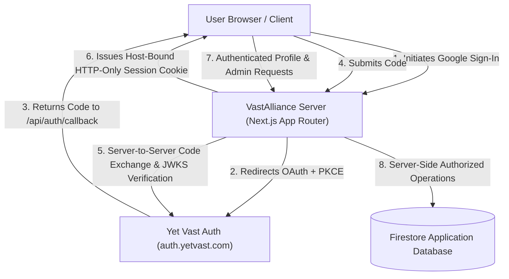

# VastAlliance — V0 Architecture & System Design

**Product:** VastAlliance  
**Development Shorthand:** `vastally`  
**Parent Umbrella:** Yet Vast Solutions (YVS)  
**Status:** V0 Foundation  
**Last Updated:** 2026-11-16  

---

## 1. System Overview

VastAlliance is an independent application under the Yet Vast Solutions umbrella designed to collect, manage, and administer structured, text-based personal bio-data profiles for a future alliance and matchmaking platform.

### Core Architectural Principles
1. **Central Identity, Local Authorization:** Yet Vast Auth (`https://auth.yetvast.com`) is the sole identity authority. VastAlliance consumes identity assertions and manages its own application-specific roles (`ADMIN` vs. `MATCH_SEEKER`) and data permissions.
2. **Flexible Bio-Data Structure:** Profiles consist of a mandatory Name and an arbitrary, extensible list of text-based custom details (`label` and `value` pairs), avoiding fixed column schemas.
3. **Deterministic & Collision-Safe Identifiers:** Every profile receives an immutable `profileId` generated on the server using the format `FIRST5YYYYmmmDDHHmmxxx`.
4. **Single Active Profile Per Seeker:** Each Match Seeker is strictly constrained to at most one active profile, atomically enforced on the server. Admins can create and moderate unlimited profiles.
5. **No AI / No Heavy Infrastructure in V0:** Adhering to the YVS Free-First and simplicity principles, V0 excludes automated matching, AI scoring, and complex media uploads.

---

## 2. Component Topology

---

## 3. Technology Stack

- **Framework:** Next.js 15 (App Router, Server Actions & Route Handlers)
- **Language:** TypeScript 5 (Strict Mode enabled)
- **Runtime:** Node.js (>=20.9.0)
- **Styling:** Pure CSS Modules + Canonical YVS Design Tokens (No Tailwind CSS)
- **Iconography:** Lucide React (Official YVS icon standard)
- **Authentication:** Official `@yetvast/auth` (v0.2.0) via GitHub Packages (`npm.pkg.github.com`)
- **Data Persistence:** Cloud Firestore (Firebase Admin SDK) with local transactional memory fallback for development/testing
- **Quality Gates:** Vitest, ESLint, TypeScript (`tsc --noEmit`), Next.js Production Build

---

## 4. Module Boundaries & Directory Layout

- `app/`: Next.js App Router endpoints
  - `(auth)/`: Sign-in, sign-out, OAuth callbacks
  - `(seeker)/`: Profile management for Match Seekers
  - `adminDahsboard/`: Protected Admin portal (exact route preservation)
  - `api/`: REST endpoints for OAuth, profiles, and moderation
- `components/`: UI components using CSS Modules
  - `auth/`: Sign-in buttons, auth state badges
  - `profile/`: Flexible bio-data form, dynamic detail rows, view cards
  - `admin/`: Metrics overview, profile table, filter bar, moderation action dialogs
  - `ui/`: Accessible modals, buttons, alerts, badges
- `lib/`: Core infrastructure
  - `auth/`: Yet Vast Auth SDK client, session management, CSRF & crypto helpers
  - `db/`: Firestore client & transactional repository interfaces
  - `profile-id/`: Server-side collision-safe ID generator
  - `tokens/`: YVS visual design tokens
- `services/`: Business logic & authorization boundaries
  - `profile.service.ts`: Ownership checks, one-profile restriction, profile mutations
  - `moderation.service.ts`: Admin status transitions (`PENDING`, `VERIFIED`, `IGNORED`), audit logs
  - `user.service.ts`: Role resolution (`ADMIN` vs. `MATCH_SEEKER`)
- `types/`: Strict TypeScript domain definitions
- `docs/`: Comprehensive project documentation and YVS reference mappings
