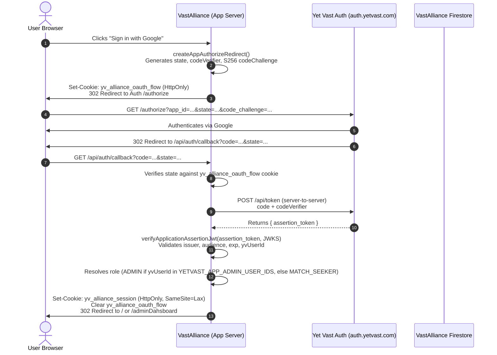

# VastAlliance — Yet Vast Auth Integration Specification

**Standard ID:** YVA-AUTH-INT-001  
**Authority:** Yet Vast Auth (`https://auth.yetvast.com`)  
**Package:** `@yetvast/auth@0.2.0`  
**Registry:** `https://npm.pkg.github.com`  
**Effective Date:** 2026-11-16  

---

## 1. Authentication Architecture

VastAlliance consumes Yet Vast Auth for central identity. It does not maintain a competing identity store, user registry, or password database.

### 1.1 Identity Principles
- **Central Identity:** Canonical `yvUserId` derived from verified Google identity (e.g., `yvnowyv`).
- **Single Identity Provider:** Google is the sole persistent identity provider in V0. GitHub sign-in is not enabled.
- **Host-Bound Session:** VastAlliance manages its own local session cookie (`yv_alliance_session`) containing the verified `yvUserId`, application role (`ADMIN` vs. `MATCH_SEEKER`), display name, and session expiry.
- **No Shared Wildcard Cookies:** The session cookie is scoped strictly to the VastAlliance application host.

---

## 2. OAuth 2.0 PKCE Authorization Code Flow



---

## 3. SDK Integration Reference

VastAlliance uses the official `@yetvast/auth/server` export:

### 3.1 Sign-In Initiation (`createAppAuthorizeRedirect`)
```typescript
import { createAppAuthorizeRedirect } from "@yetvast/auth/server";

const { authorizeUrl, state, codeVerifier } = createAppAuthorizeRedirect({
  authServerOrigin: process.env.YETVAST_AUTH_ORIGIN || "https://auth.yetvast.com",
  applicationId: process.env.YETVAST_APP_ID || "vastalliance",
  redirectUri: `${appOrigin}/api/auth/callback`,
  provider: "google",
});
```

### 3.2 Token Exchange & Verification (`exchangeCodeForAssertion`)
```typescript
import { exchangeCodeForAssertion } from "@yetvast/auth/server";

const { assertion } = await exchangeCodeForAssertion({
  authServerOrigin: process.env.YETVAST_AUTH_ORIGIN || "https://auth.yetvast.com",
  applicationId: process.env.YETVAST_APP_ID || "vastalliance",
  code,
  redirectUri: `${appOrigin}/api/auth/callback`,
  codeVerifier,
  jwksUrl: `${process.env.YETVAST_AUTH_ORIGIN || "https://auth.yetvast.com"}/.well-known/jwks.json`,
  expectedIssuer: process.env.YETVAST_AUTH_ORIGIN || "https://auth.yetvast.com",
  expectedAudience: process.env.YETVAST_APP_ID || "vastalliance",
});
```

### 3.3 Admin Identification (`YETVAST_APP_ADMIN_USER_IDS`)
Per Yet Vast standards:
- The server inspects `process.env.YETVAST_APP_ADMIN_USER_IDS` (comma-separated list of canonical `yvUserId` strings).
- If `assertion.yvUserId` is present in this allowlist, the VastAlliance role is set to `ADMIN`.
- Otherwise, the user is assigned the role `MATCH_SEEKER`.
- Never trust client-submitted role parameters.
